# 🤖 Knowbase

<p align="center">
  <strong>AI knowledge assistant for teams</strong><br />
  Ask questions in plain English and get answers grounded in company documents, with citations that link back to the source page.
</p>

<p align="center">
  
  
  
  
  
  
</p>

> [!NOTE]
> **Project status:** actively developed. The repository runs locally with Docker Compose; it is not a production deployment package.

---

## 📚 Contents

- [Why Knowbase](#-why-knowbase)
- [Features](#-features)
- [Screenshots](#-screenshots)
- [How it works](#-how-it-works)
- [Technology stack](#-technology-stack)
- [Getting started](#-getting-started)
- [Project structure](#-project-structure)
- [Planned improvements](#-planned-improvements)
- [Author](#-author)
- [License](#-license)

## 💡 Why Knowbase

Company knowledge is often scattered across PDFs, handbooks, and policy documents. Finding a simple answer—such as “how many sick leave days do I get?”—can mean opening several files and skimming through them. Generic chatbots can make things up and do not know who is allowed to see each document.

Knowbase addresses three problems:

| Challenge | How Knowbase helps |
|---|---|
| Answers are hard to find | Natural-language Q&A over uploaded documents |
| AI can hallucinate | Answers come from retrieved passages with verified citations. If nothing relevant is found, the assistant says so. |
| Document access differs | Backend access rules for everyone, selected roles, or selected users are applied before text reaches the AI. |

## ✨ Features

| Feature | What it does |
|---|---|
| 💬 **Grounded Q&A with citations** | Shows document, page, and excerpt for sources; validates citations against retrieved passages. |
| 📄 **Document upload and indexing** | Processes PDF, DOCX, TXT, and Markdown files through a background worker with status, progress, and retries. |
| 🔐 **Access control** | Applies admin/user permissions, employee roles, and per-document access rules to both document listing and AI retrieval. |
| 🧑‍💼 **Admin tools** | Supports employee management, role assignment, password resets, and workspace analytics. |
| 🗂️ **Private history** | Keeps each user's conversations and search history visible only to that user. |
| 📝 **Feedback and escalation** | Provides thumbs-up/down feedback and escalation on answers. |
| 👁️ **PDF preview** | Opens authorized source documents in the browser. |

## 🖼️ Screenshots

<p align="center">
  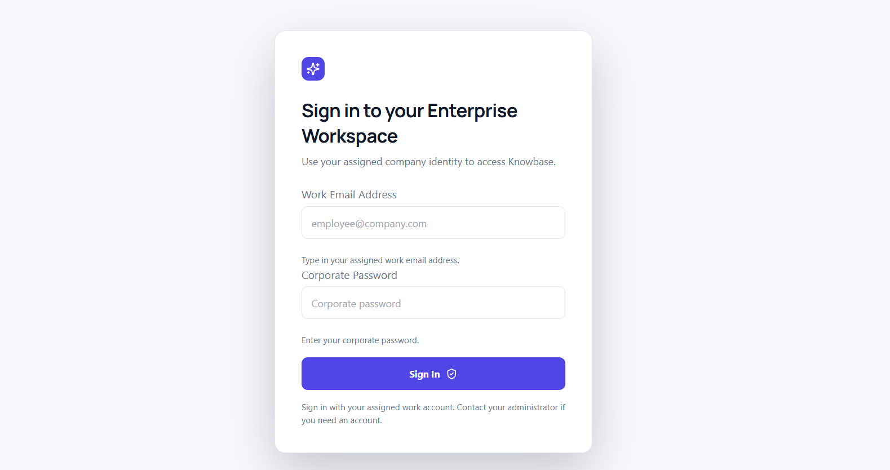
  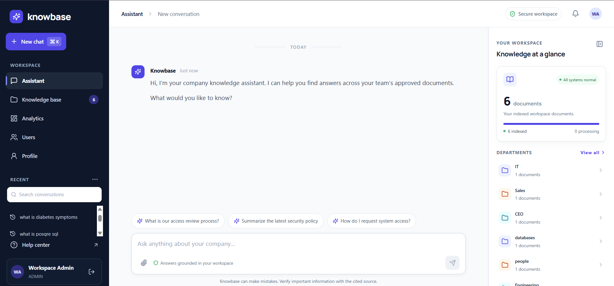
</p>

<p align="center">
  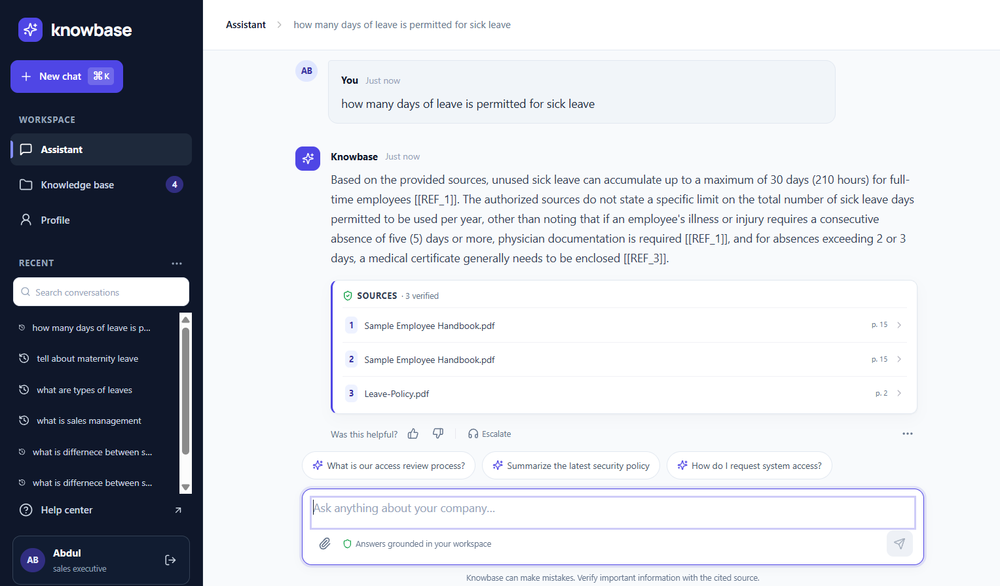
  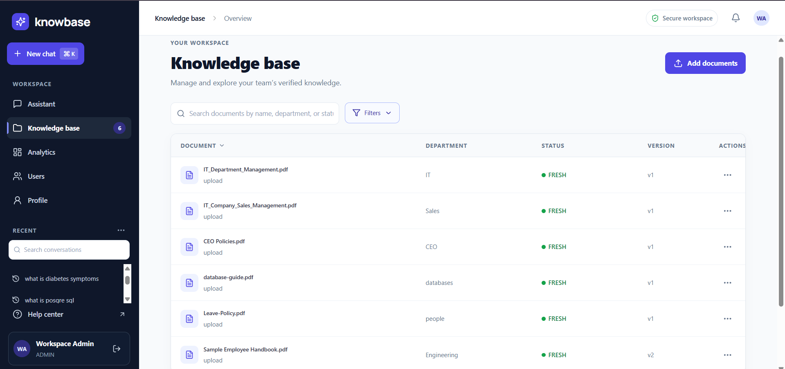
</p>

<details>
<summary>📷 View more screenshots</summary>
<br />

<p align="center">
  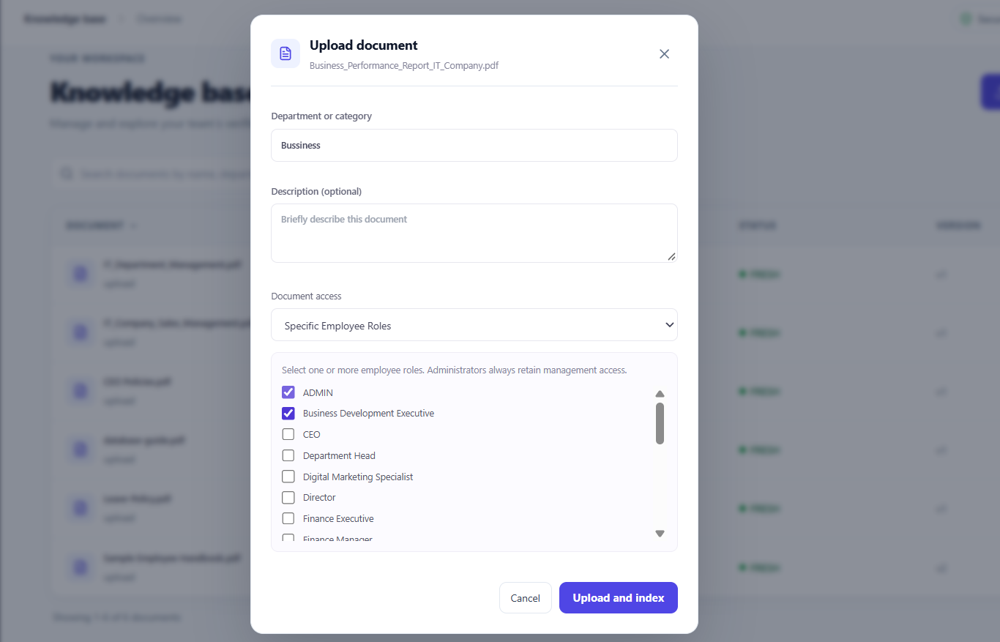
  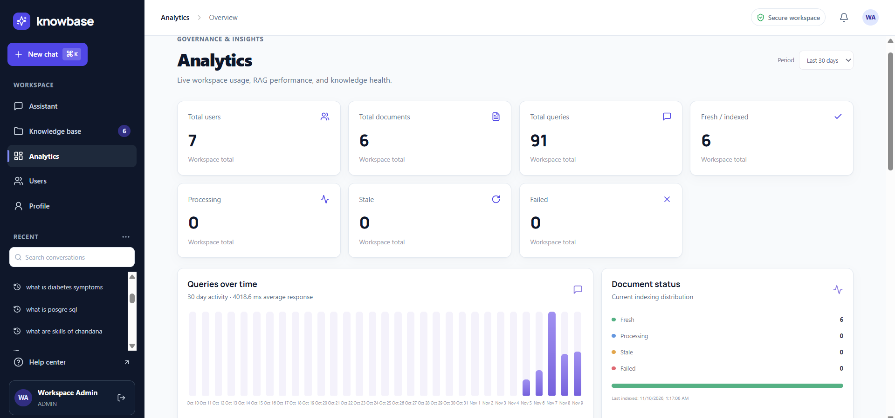
</p>

<p align="center">
  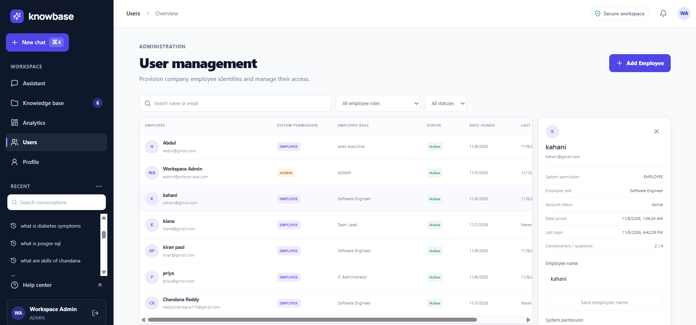
  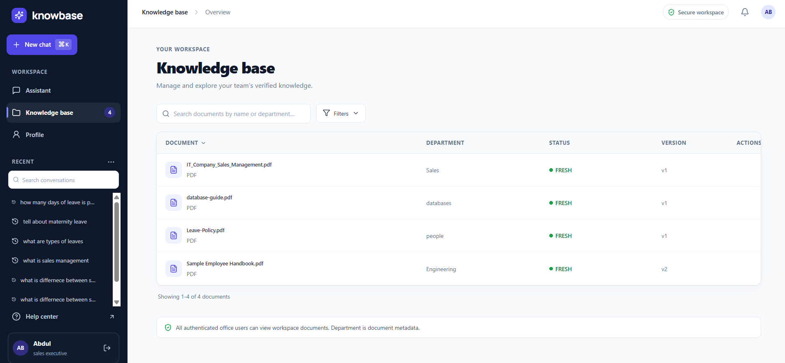
</p>

<p align="center">
  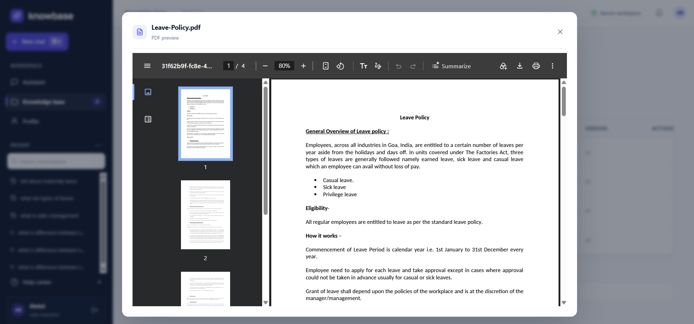
  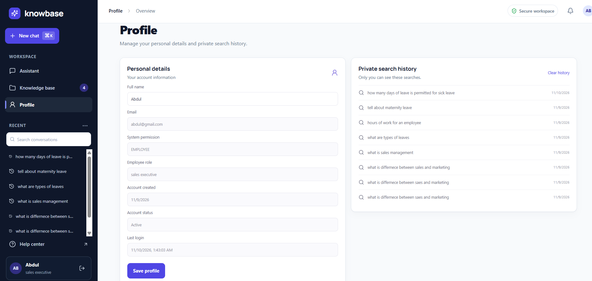
</p>
</details>

## ⚙️ How it works

Knowbase uses a retrieval-augmented generation (RAG) pipeline with document access checks built in.

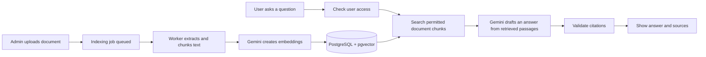

### Document indexing

1. An admin uploads a file and chooses its access policy.
2. The API stores the file and queues an indexing job in PostgreSQL, allowing the upload request to return promptly.
3. A background worker extracts text, splits it into overlapping chunks (1,100 characters, with 140 characters of overlap), and generates embeddings with Gemini.
4. Vectors are stored in pgvector. When a document is replaced, its new version takes over only after indexing is ready.

### Question answering

1. The API determines which documents the user may access.
2. It runs vector similarity search only across those documents.
3. The most relevant passages and the question are sent to Gemini to draft an answer.
4. Citation references are checked against the retrieved passages. If no relevant evidence is found, the app returns a “no answer” response instead of guessing.

> [!IMPORTANT]
> **Authorization is enforced by the backend, not the UI.** The same access rule is used for document listing and retrieval, then checked again just before the prompt is built.

## 🧰 Technology stack

| Layer | Technologies |
|---|---|
| Frontend | React 18, TypeScript, Vite, Axios |
| Backend | Python 3.12, FastAPI, SQLAlchemy 2 (async), Pydantic |
| Database | PostgreSQL 16, pgvector |
| AI | Google Gemini for answers and embeddings |
| Document parsing | pypdf, python-docx |
| Authentication | JWT, bcrypt, role-based access |
| Infrastructure | Docker Compose |

## 🚀 Getting started

### Prerequisites

- Docker Desktop
- Node.js and npm
- A Google Gemini API key

### 1. Configure the backend

```bash
cp backend/.env.example backend/.env
```

Edit `backend/.env` and set `JWT_SECRET`, `GEMINI_API_KEY`, `ADMIN_EMAIL`, and `ADMIN_PASSWORD`.

### 2. Start the database and API

```bash
docker compose up -d --build
```

### 3. Create the first admin

```bash
docker compose exec api python -m app.seed
```

### 4. Run the frontend

```bash
npm ci
npm run dev
```

Open [http://localhost:5173](http://localhost:5173) and sign in with the admin account.

### Local service URLs

| Service | URL |
|---|---|
| Frontend | [http://localhost:5173](http://localhost:5173) |
| API documentation (Swagger) | [http://localhost:8000/docs](http://localhost:8000/docs) |
| API health check | [http://localhost:8000/health](http://localhost:8000/health) |

> [!TIP]
> Public sign-up is disabled by design. Admins create employee accounts from the **Users** page.

## 🗂️ Project structure

```text
.
├── src/                   # React app: chat, knowledge base, and admin UI
├── backend/app/
│   ├── main.py            # API routes
│   ├── rag.py             # Embeddings, retrieval, and answer generation
│   ├── indexing.py        # Background indexing queue and worker
│   ├── connectors.py      # PDF, DOCX, TXT, and Markdown extraction
│   ├── security.py        # JWT, password hashing, and access rules
│   └── models.py          # Database models
├── docs/screenshots/
└── docker-compose.yml
```

## 🧭 Planned improvements

- Automated tests, including end-to-end checks for permissions and retrieval
- Versioned database migrations (Alembic)
- Production deployment setup with managed secrets, TLS, and object storage
- Single sign-on (SSO) support

## 👤 Author

**[Anumula Chandana]** · [LinkedIn](https://www.linkedin.com/in/chandana1821/) · [Email](mailto:anumulachandana18@gmail.com)

## 📄 License

No license file is currently included. All rights reserved unless a license is added.
